# The Expedition: Mage Knight-style exploration

**Status:** design draft for review (2026-10-12). Nothing here is implemented yet.

The Expedition replaces the campaign's linear encounter list (see [Campaign progression](campaign.md)) with a map you explore. It borrows Mage Knight's exploration — one hand of cards pays for everything, the map grows tile by tile, your deck is your clock — and hands every fight to **our existing battle system, unchanged**.

The pictures are in [`expedition/`](expedition/).

## Contents

1. [Inspiration: Mage Knight](#1-inspiration-mage-knight)
2. [The bridge: one deck, two arenas](#2-the-bridge-one-deck-two-arenas)
3. [A region](#3-a-region)
4. [A turn](#4-a-turn)
5. [The clock](#5-the-clock)
6. [Energy](#6-energy)
7. [Encounters](#7-encounters)
8. [The Warlord](#8-the-warlord)
9. [Defeat and wounds](#9-defeat-and-wounds)
10. [Economy](#10-economy)
11. [Growth and gear](#11-growth-and-gear)
12. [Between regions](#12-between-regions)
13. [Worked example](#13-worked-example)
14. [Configurable values](#14-configurable-values)
15. [What it would take to build](#15-what-it-would-take-to-build)
16. [Open questions](#16-open-questions)
17. [Decision log](#17-decision-log)

---

## 1. Inspiration: Mage Knight

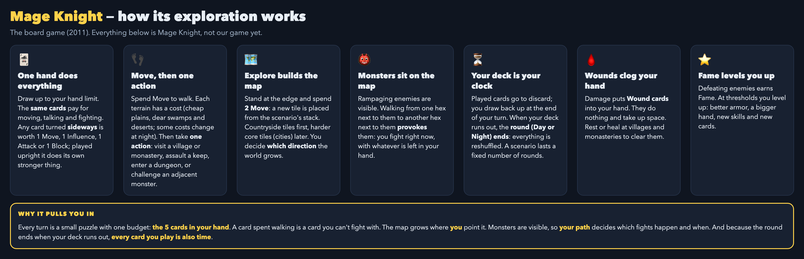

**What we take:** one hand pays for walking, talking and fighting; terrain costs; exploring by placing new tiles; visible monsters you can provoke; a fixed number of Day and Night rounds that each last one deck; fortified sites; experience that makes you stronger.

**What we don't take:** Mage Knight's card-based combat. Every fight is a full battle in our system.

## 2. The bridge: one deck, two arenas

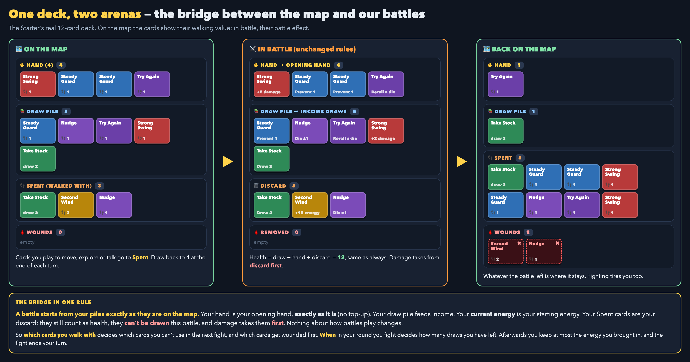

**A battle starts from your map state exactly as it is:**

| On the map | In the battle |
| --- | --- |
| Hand | Opening hand, **as it is** — no top-up |
| Draw pile | Draw pile (Income draws from it) |
| Spent cards (played this round) | Discard |
| Wounds (their cards) | Removed |
| Current energy | Starting energy |

The battle then plays by today's rules, including no recycling of discard and damage taking cards **discard → draw → hand**. When it ends, whatever is left goes back to the map, the fight **ends your turn**, and you keep at most the energy you brought in (see [Energy](#6-energy)).

So on the map:

- **Which cards you walk with** decides which cards you can't draw in the next fight — and which get wounded first, because damage takes discard first.
- **When in a round you fight** decides how many Income draws you have left.
- Health never changes from walking: Spent cards still count as health. Only removal loses health.

## 3. A region

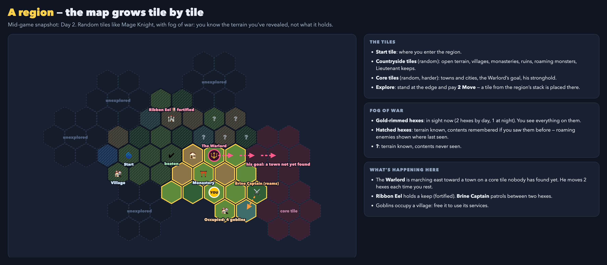

- **Hex map built from random tiles**, like Mage Knight: a **start tile**, then **countryside tiles** (open terrain, villages, monasteries, ruins, roaming monsters, Lieutenant keeps), then harder **core tiles** (towns and cities, the Warlord's goal, his stronghold). First scenario: start tile, about 5 countryside tiles and 2 core tiles.
- **Explore:** standing next to an empty tile position, pay **2 Move** to place the next tile from the region's stack.
- **Fog of war:**
  - In sight (2 hexes by day, 1 at night): you see everything on those hexes.
  - Revealed but out of sight: the terrain is shown greyed out. Sites you've already seen stay on your map; roaming enemies are shown where you last saw them.
  - Never seen: terrain only, contents unknown.
- **On the map:** villages, monasteries, towns, ruins, grottos, **event sites**, Lieutenants (roaming on patrol, or **fortified** in a keep), groups of minions, occupied villages to free, and the Warlord.
- **Event sites** work like Slay the Spire's "?" rooms: stepping on one starts a short scene with 2–3 choices.
  - Choosing well earns a bonus (gold, XP, gear, mended damage); choosing badly costs something (a wound named after the event, gold, a fight).
  - Some choices need something from you: Influence, gold, a die roll, or giving up a card for the round.

## 4. A turn

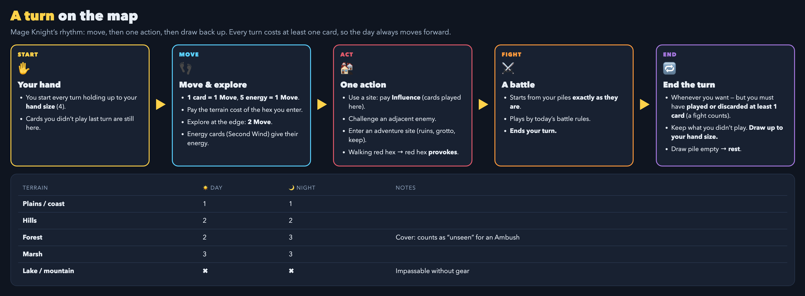

1. **Start:** your hand holds up to your **hand size** (4). Cards you didn't play last turn are still there.
2. **Move and explore:** **1 card = 1 Move**; **5 energy = 1 Move**. Pay the terrain cost of each hex you enter. Exploring costs 2 Move. Cards whose effect gains energy (Second Wind) give that energy on the map; ordinary cards can't be turned into energy.
3. **One action:** use a site (paying Influence), challenge an adjacent enemy, or enter an adventure site.
4. **A fight**, if one starts, ends your turn.
5. **End the turn** whenever you like, as long as you've **played or discarded at least 1 card** this turn (a fight counts). Keep the cards you didn't play and **draw up to your hand size**. If no card is left in your hand or draw pile at the end of the turn, the round is over and you **rest**; cards still in hand carry on into the next turn (see [The clock](#5-the-clock)).

**Hand symmetry:** the map and battles share one hand size and one hand limit (6). Anything that raises or lowers them — a level-up, gear, an enemy's "Shaken: hand size −1" status — applies to both. Effects like that are visible statuses with their expiry shown.

**Terrain costs (first draft):**

| Terrain | Day | Night | Notes |
| --- | ---: | ---: | --- |
| Plains / coast | 1 | 1 | |
| Hills | 2 | 2 | |
| Forest | 2 | 3 | Cover: counts as "unseen" for an Ambush |
| Marsh | 3 | 3 | |
| Lake / mountain | ✖ | ✖ | Impassable without gear |

## 5. The clock

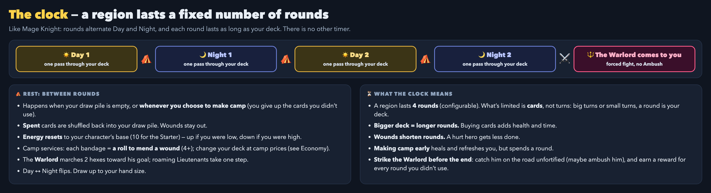

- A region lasts **4 rounds**, alternating **Day and Night** (configurable). Each round lasts **one pass through your deck**. What's limited is cards, not turns.
- **Rest** happens when **no card is left in your hand or draw pile at the end of a turn** (one pass through the deck is one round — the Warlord's clock; an empty draw pile alone never forces a camp while you still hold cards, for example after a battle), **whenever you choose to make camp** (you give up the cards you didn't use), or after a **defeat** (a forced rest). The camp says why: "Camp · the deck ran out — Round N is over: no cards were left in your hand or draw pile at the end of turn N."
  1. Spent cards are shuffled back into your draw pile. Wounds stay out. (This is an explicit recovery outside battle; battles still never recycle.)
  2. **Energy resets** to your character's base.
  3. **Your fresh hand is drawn** up to your hand size, right away. The camp always shows a full hand beside the reshuffled draw pile, never an empty hand beside a full pile.
  4. **Camp:** **basic first aid** on each untreated wound (1d3), then **bandages** on treated wounds (1d6) — see [Defeat and wounds](#9-defeat-and-wounds); play cards from the fresh hand for **Influence** (1 card = 1 Influence, paid out of the round's opening hand, the same cost as Influence at a village); open your deck with **3 Influence**, then change it as often as your XP allows until you break camp.
  5. The Warlord marches 2 hexes toward his goal; roaming Lieutenants take one step.
  6. Day ↔ Night. **Breaking camp draws nothing**: the hand was drawn at step 3.
- **Bigger deck = longer rounds.** Buying cards adds health and time. **Wounds shorten rounds.**
- **Night** differs, like Mage Knight. Night does **not** make ambushes automatic.

| | Day | Night |
| --- | --- | --- |
| Terrain | Normal costs | Forest costs 3 |
| Sight (you and enemies) | 2 hexes | Adjacent hexes only |
| Enemy habits | Night hunters rest: they can be ambushed | Sleepers can be ambushed; night hunters roam, moving 1 hex each turn instead of each rest |
| Grottos and ruins | Normal rewards | Better loot, stronger guardian |
| Villages and towns | All services | Closed, except the inn: a safe rest, +1 on every camp healing roll |
| Monasteries | Open | Open |
| The Warlord | His own habits and weaknesses | His own habits and weaknesses; Fortified if he's camped in a tower or keep |
- After the last round you take the normal rest, then **the Warlord comes to you**: a forced fight, starting with a fresh hand, with every buff he still has and no Ambush.

## 6. Energy

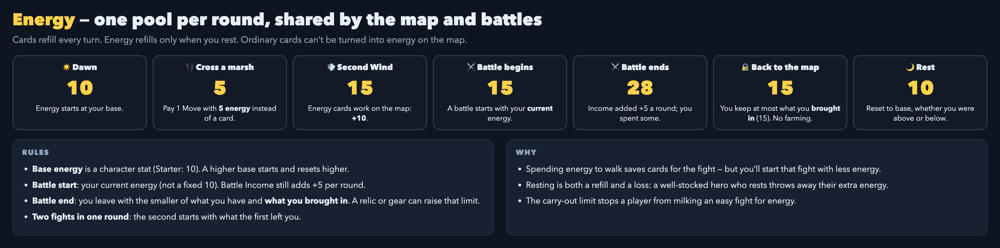

- **Base energy** is a character stat (Starter: 10). A higher base starts and resets higher.
- **One pool per round**, shared by the map and battles. Cards refill every turn; energy refills only when you rest.
- **Battle start:** your current energy. Battle Income still adds +5 per round.
- **Battle end:** you leave with the **smaller of** what you have and **what you brought in**. This stops anyone farming an easy fight for energy. Relics and gear may raise this limit.
- **Rest:** reset to base, whether you were above it (you lose the extra) or below it (you're refilled).

## 7. Encounters

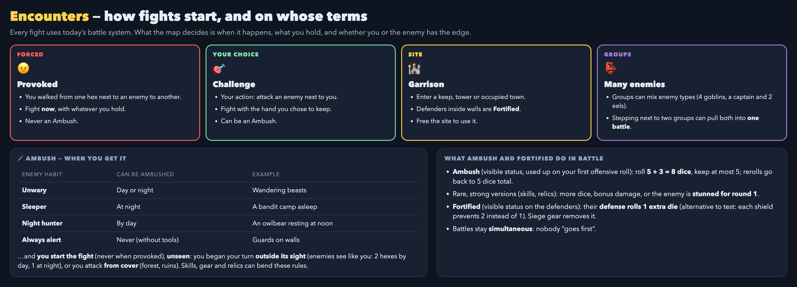

- **Provoked:** walking from one hex next to an enemy to another hex next to it starts a fight **now**, with whatever you hold. Never an Ambush.
- **Challenge:** your action; attack an enemy next to you with the hand you chose to keep.
- **Garrison:** entering a keep, tower or occupied town fights its defenders. Defenders inside walls are **Fortified**.
- **Groups:** a group can mix enemy types (four goblins; a captain and two eels). Stepping next to two groups can pull both into one battle.

**Ambush:**

- You **start the fight yourself** (never when provoked), **unseen**, against an enemy whose **habit** allows it right now.
- **Unseen** means either:
  - you **began your turn outside the target's sight** — enemies see the way you do: 2 hexes by day, 1 at night — so the approach itself matters; or
  - you attack **from cover**: a forest or ruins hex.
- **Habits:**

| Habit | Can be ambushed | Example |
| --- | --- | --- |
| Unwary | Day or night | Wandering beasts |
| Sleeper | At night | A bandit camp asleep |
| Night hunter | By day | An owlbear resting at noon |
| Always alert | Never (without tools) | Guards on walls |

- Skills, gear and relics can bend these rules.
- **Effect (default):** a visible **Ambush** status, used up on your first offensive roll. That roll uses **5 + 3 = 8 dice**; you may keep at most 5; each reroll goes back to 5 dice total (keep 3, reroll 2).
- Rare, strong versions (skills, relics) may add more dice, bonus damage, or **stun the enemy for round 1**. Battles stay **simultaneous**: nobody acts first.

**Fortified:** a visible status on defenders inside walls that strengthens their **defense**. Default: their defensive roll uses **1 extra die**. Alternative to test: each shield result prevents **2 instead of 1**. Siege gear removes it. A card that removes it in battle takes it off only for the rest of that round: Fortified, Conqueror and Lieutenant's Favor come back at every round's Ongoing Effects (`restore_each_round`).

## 8. The Warlord

**His agenda.** Each region gives the Warlord a goal on a core tile, usually conquering a town. His route is laid out when the region is built.
- He starts **about 5 hexes** from his goal and marches **2 hexes each time you rest**.
- With no extra rests he arrives at the **third rest**, just before the last round.
- Every early camp and every defeat (a forced rest) **speeds him up**.
- He's shown where you last saw him. Once you've seen him, his next step is visible.

**Lieutenants** each give him a visible buff. Kill them to remove those buffs. A Lieutenant may roam on patrol or sit fortified in a keep.

**Catch him early.** On the road he's an enemy on a hex like any other:
- challenge him from an adjacent hex, **unfortified**;
- like any enemy, **each Warlord has his own habits and weaknesses**, by day or by night (one may be a night hunter, another may sleep in a camp). Learn them, approach unseen when his habit allows it, and you earn an **Ambush**. At night he's **Fortified** only if he's camped in a tower or keep;
- beating him before the deadline pays **+30 XP for each round you didn't use**, plus **one extra relic choice**.

**If he reaches his goal**, he takes the town:
- its services are gone;
- he waits there **Fortified**, and storming him means fighting through his walls;
- he gains a visible **Conqueror** buff (+1 defensive die). This is a consequence you could have prevented, not automatic growth.

**At the deadline** (after the last round) he comes to you, wherever you are:
- he brings every buff he still has, and there's no Ambush;
- he isn't Fortified in the open field.

**Losing to the Warlord ends the run.** Nothing else does.

## 9. Defeat and wounds

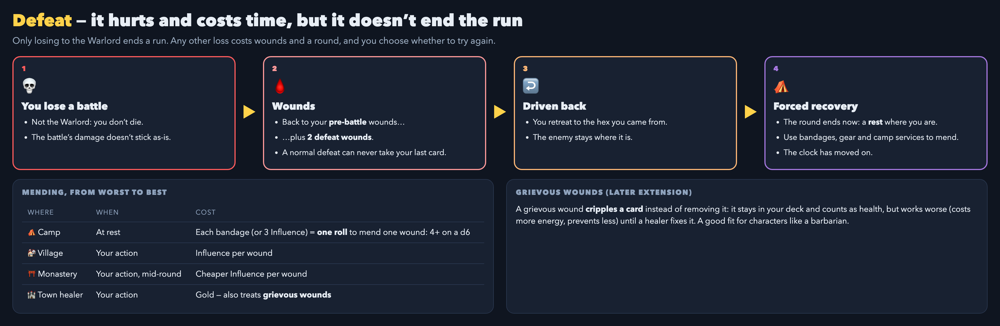

**A wound is a grouping of damage**, exactly as the battle's wound ledger records it ("Wound 1 · 6 damage · Round 5 · Brine Lash · Cards lost: …"): the cards one damage source removed together. The map keeps the same groupings instead of counting cards as wounds. A wound's damage is the number of cards still in it; healing takes cards out of it, and a wound healed to zero damage does not exist any more. **Health lost is the number of wounded cards, not the number of wounds.** Every battle hit that removed cards comes to the map as one wound named after the ability (or card, or attacker) with the battle round it landed in; a defeat is one wound named after the enemy; an event that costs a wound inflicts one wound named after the event.

**Coming back from a battle:** the piles come back as the battle left them, but a battle can never leave you better off than you went in. From the worst pile to the best — removed, Spent, draw pile, hand — each tier together with the better ones holds at most what it held going in: your hand at most its pre-battle size, hand and draw pile together at most theirs, and so on, so your wounds can only grow. A pile over its limit keeps a random selection of its own cards and the rest drop to the next pile with room. Energy is likewise at most what you brought in. Example: 4 in hand, 4 in the draw pile, 4 Spent going in; 5, 5 and 2 coming out → a random 4 of the hand, a random 4 of the draw pile, and the other two go to Spent. You return to the map and keep playing with what is left; you only rest when no card is left in hand or draw pile, or when you make camp.

**Losing a normal battle:**

1. Your piles and wounds go back to their **pre-battle** state, **plus one defeat wound of 2 damage** (`defeat.wounds` is the damage, not a count). A normal defeat can never take your last live card.
2. You're **driven back** to the hex you came from. The enemy stays.
3. **Forced recovery:** the round ends with a rest where you stand. The clock has moved on.

**Camp healing.** At every rest, after the reshuffle, the energy reset and the fresh hand:

1. **Basic first aid** — every character has it, free. For each **untreated** wound, roll **1d3** and heal that many points from it (the cards return to the draw pile at a seeded position). A wound healed to zero goes away. Otherwise it is now **treated**, and basic aid cannot be used on it again at this camp.
2. **Bandages** — a bandage from your pack gives a **treated** wound a second attempt: roll **1d6** and heal that many points. One bandage per wound per camp; the wound is then **bandaged**.
3. After that, nothing more heals a wound at that camp except special abilities. Influence and deck changes stay open.
4. **The next camp resets everything:** every wound is untreated again and gets another attempt.

Resting at an **inn** adds **+1** (`camp_healing.inn_bonus`) to each healing roll. Gear and relics can improve the dice.

**Mending, worst to best:**
1. **Camp:** basic aid on every untreated wound, free (1d3 each); then a bandage per treated wound (1d6 each).
2. **Village:** Influence per point of damage — one card per payment.
3. **Monastery:** cheaper per point, and possible mid-round.
4. **Town healer:** gold per point; later also treats grievous wounds.

**Grievous wounds (later extension):** a wound that **cripples a card** instead of removing it. The card stays in your deck and counts as health but works worse (costs more energy, prevents less) until a healer fixes it. A good fit for characters like a barbarian.

## 10. Economy

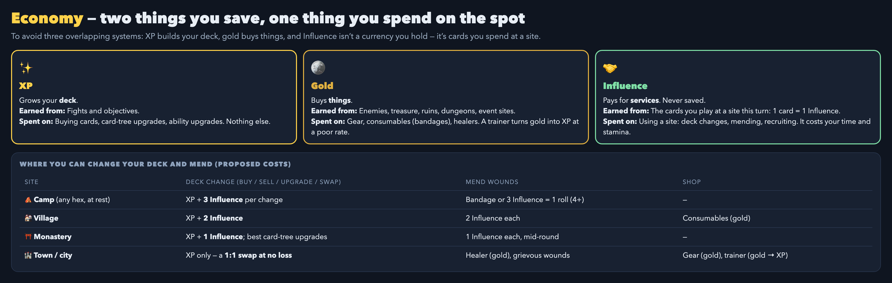

*The illustration is from the first draft: since then the trainer was removed (gold never buys XP), the deck-change fee is paid once per visit, and camp healing changed. The tables below are current.*

To avoid three overlapping systems, there are **two things you save and one thing you spend on the spot**:

| | Earned from | Spent on |
| --- | --- | --- |
| **XP** — grows your deck | Fights, objectives | Buying cards, card-tree upgrades, ability upgrades. Nothing else. |
| **Gold** — buys things | Enemies, treasure, ruins, dungeons, event sites | Gear, consumables (bandages), healers. Gold never buys XP and can never upgrade a card directly. |
| **Influence** — never saved | The cards you play at a site this turn (1 card = 1 Influence), or energy (`influence.energy_per_influence`, 5 energy = 1 Influence) | Site services: deck changes, mending, recruiting |

**Deck changes cost time and place.** Changing your deck (buy, sell, upgrade, swap) happens only at sites, and costs XP **plus** an Influence fee by site tier. The fee is paid **once per visit**: the first change opens the deck, and every further change there costs XP only until you leave (break camp, or end the turn at a site). A player can shape their deck however they like, but not rebuild it for free before every fight.

| Site | Deck change | Mend wounds | Shop |
| --- | --- | --- | --- |
| Camp (any hex, at rest) | 3 Influence opens the deck until you break camp; then XP per change | Basic aid, free: 1d3 per untreated wound; then a bandage: 1d6 per treated wound | — |
| Village | 2 Influence opens the deck this turn; then XP per change | 2 Influence per point of damage (one card) | Consumables (gold) |
| Monastery | 1 Influence opens the deck this turn; then XP per change; best card-tree upgrades | 1 Influence per point, mid-round | — |
| Town / city | XP only: a straight 1:1 swap, no Influence | Healer: 15 gold per point; grievous wounds later | Gear (gold) |

These costs are a first pass. Mage Knight charges 3 Influence per wound at a village and 2 at a monastery. Ours are lower, and charged per point of damage, because our Influence is cards from a 4-card hand.

**Gold, first pass.** XP uses the card value rules (a base card costs 15 XP, a blank card 10; see [card-value-rules.md](card-value-rules.md)). Gold uses its own numbers:

| Source | Gold | | Price | Gold |
| --- | ---: | --- | --- | ---: |
| Minion group | 5–15 | | Bandage | 10 |
| Lieutenant | 30 | | Consumable | 15–30 |
| Treasure / ruins | 20–40 | | Gear | 40–100 |
| Event site | 0–30 | | Healer (grievous wound) | 50 |
| Warlord | 60 | | | |

## 11. Growth and gear

- **XP** buys cards and upgrades, as today, at sites.
- **Gear** comes from ruins, grottos, shops and objectives. A piece of gear may:
  - **add a card** to your deck (more health and longer rounds);
  - **improve a card**;
  - **improve an ability or your defense**.
- **Relics** are run-scoped, as already decided for the run layer.
- **Hand size**, **base energy** and the **energy carry-out limit** are character stats that levels, gear and relics can raise.
### Cards for the map, for battle, or for both

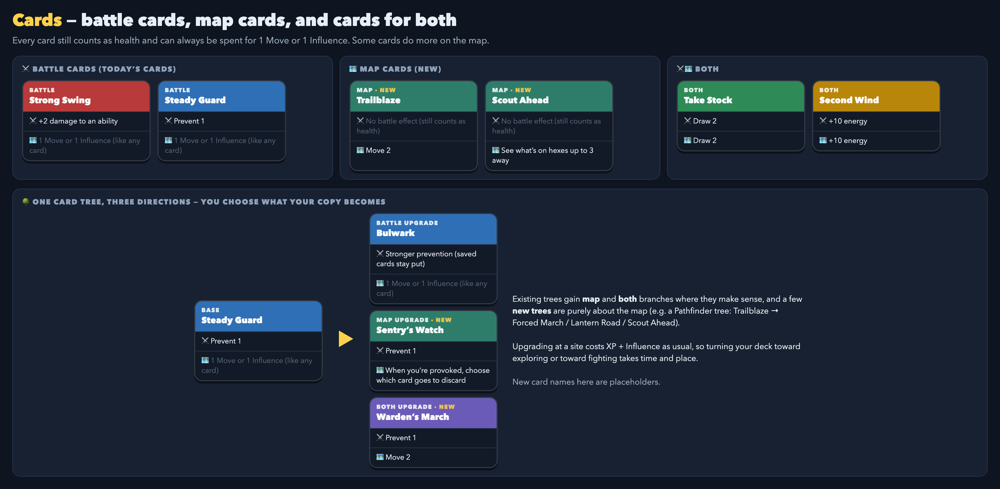

Every card counts as health and can always be spent for **1 Move or 1 Influence**. On top of that there are three kinds:

| Kind | In battle | On the map | Examples |
| --- | --- | --- | --- |
| **Battle cards** (today's cards) | Their battle effect | 1 Move or 1 Influence | Strong Swing, Steady Guard |
| **Map cards** (new) | No battle effect — still health, but a dead draw in a fight | A map effect stronger than 1 Move | Trailblaze (Move 4), Scout Ahead (see hexes up to 3 away) |
| **Both** | Their battle effect | Their own map effect | Take Stock (draw 2), Second Wind (+10 energy) |

**Card trees grow in both directions.** Existing trees gain **map** and **both** branches where they make sense, and a few **new trees** are purely about the map (for example a Pathfinder tree: Trailblaze → Forced March / Lantern Road / Scout Ahead). When you upgrade a copy, you choose what it becomes: stronger in battle, useful on the map, or a bit of both. Upgrading at a site costs XP plus Influence as usual, so turning your deck toward exploring or fighting takes time and place. (New card names are placeholders.)

**Map cards are unplayable in battle by default.** That's a deliberate weakness: the more you build for exploring, the weaker your fights. Abilities, gear and card upgrades can later cover the gap (for example, a map card that also gains a small battle use). Naming the game's weaknesses on purpose is what creates build paths that feel good to complete.

**Playing a card for its map effect costs its printed energy**, as in battle: Take Stock (5 energy) costs 5 map energy to draw 2 on the map; Second Wind (0) costs nothing. Spending any card as 1 Move or 1 Influence costs no energy. A map effect may also author a map-only `energy_cost`, paid on top of the printed cost.

**Map-only energy costs are allowed, but rare and big.** In battle, energy comes back every round (Income, cards). On the map it comes back **only when you rest**, so the energy you have at the start of a round is all you get for the round. A map effect that costs energy must therefore be **big** enough to be worth part of that pool (e.g. Move 4 and ignore terrain costs, not Move 3). Most map effects cost no energy. Energy-costing map effects belong on specific card-tree upgrades, and they need careful tuning.

**Gear** can also be a card (strong on the map, weak in battle, or the reverse), and every card it adds is more health and a longer round.

## 12. Between regions

- **Carries over:** XP, cards, gear, relics, and wounds.
- **Between regions** there's a camp and healer stop: mend wounds; treat grievous wounds with gold.

## 13. Worked example

The Starter's real 12-card deck, Day 1.

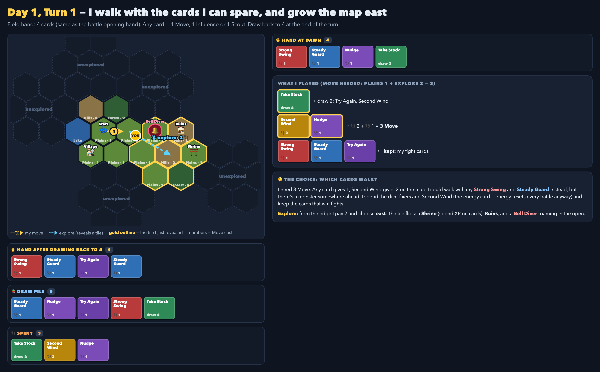

**Turn 1:** I need 3 Move (1 for plains, 2 to explore). I walk with Take Stock, Second Wind and Nudge, and keep Strong Swing, Steady Guard and Try Again for a fight. Exploring east reveals a Monastery, Ruins and a Bell Diver.

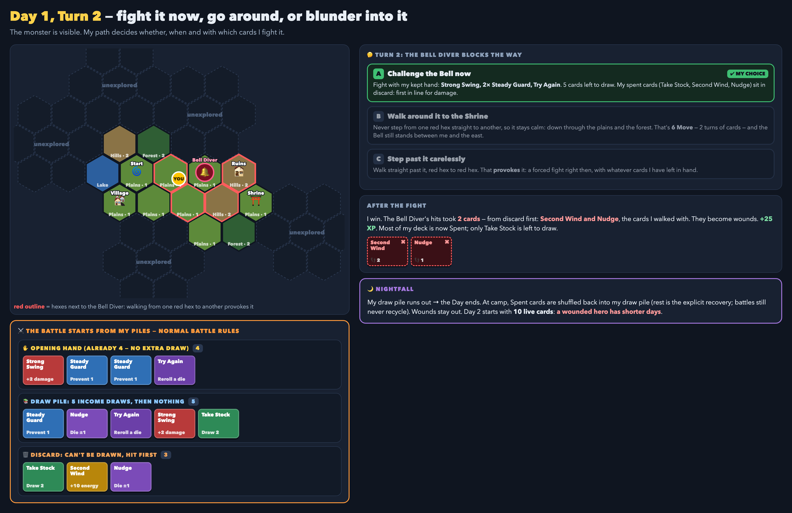

**Turn 2:** I can challenge the Bell Diver with the hand I kept, spend two turns walking around it, or blunder past and be provoked. I fight. The battle starts from my piles; one hit takes **Second Wind and Nudge** — the cards I walked with — as one wound of 2 damage. My draw pile runs out and I rest: the fresh hand is drawn, basic aid rolls 1d3 on that wound, and the next round starts with 10 live cards plus whatever it healed.

## 14. Configurable values

**Every number in this doc is a first guess that will change in playtesting.** None of them belong in code. They live in content files the authority loads, in the same style as `content/progression_v1/campaign.yaml` and `economy.yaml`:

- **Expedition rules:** one file, e.g. `content/progression_v1/expedition.yaml` — rounds, hand size, terrain costs, sight, ambush, fortified, defeat, camp healing, site mending, the Warlord's pace, rewards, Influence costs and gold.
- **Per character:** base energy, hand size and limit, energy carry-out — on the character sheet.
- **Per enemy:** habit, gold drop, XP — on the enemy or encounter definition.
- **Per card:** its map effect (if any) — in the card's catalog definition, next to its battle `program`; edited in the card editor's Card tab (“On the Expedition map”: effect, amount, extra map energy, Move's terrain options, text) and in the tree forge's quick steppers.
- **Per region:** tile stack, Lieutenants, the Warlord and his goal — in the region definition.

A sketch of the rules file (names are illustrative):

```yaml
schema_version: 1
rounds_per_region: 4          # alternating day/night, day first
hand: { size: 4, limit: 6 }   # shared by map and battle
move: { energy_per_move: 5, explore_cost: 2 }
terrain:
  plains: { day: 1, night: 1 }
  forest: { day: 2, night: 3, cover: true }
  hills:  { day: 2, night: 2 }
  marsh:  { day: 3, night: 3 }
sight: { day: 2, night: 1 }
ambush: { bonus_dice: 3, max_kept: 5 }
fortified: { extra_defense_dice: 1 }
defeat: { wounds: 2 }         # one defeat wound of this much damage
camp_healing: { basic_aid_die: 3, bandage_die: 6, inn_bonus: 1 }
mending: { village_influence_per_wound: 2, monastery_influence_per_wound: 1, town_gold_per_wound: 15 }  # per point of damage
warlord: { start_distance: 5, march_per_rest: 2, early_reward: { xp_per_round: 30, extra_relic_choices: 1 } }
deck_change_influence: { camp: 3, village: 2, monastery: 1, town: 0 }   # paid once per visit
gold:
  drops: { minion_group: [5, 15], lieutenant: 30, treasure: [20, 40], event: [0, 30], warlord: 60 }
  prices: { bandage: 10, consumable: [15, 30], gear: [40, 100], healer_grievous: 50 }
```

| Value | First guess |
| --- | --- |
| Rounds per region | 4 (Day, Night, Day, Night) |
| Hand size (map and battle) | 4 |
| Hand limit (map and battle) | 6 |
| Base energy (Starter) | 10 |
| Energy per Move | 5 |
| Explore cost | 2 Move |
| Terrain costs | See [A turn](#4-a-turn) |
| Sight (you and enemies) | 2 hexes by day, 1 at night |
| Ambush bonus dice | +3 on the first offensive roll (keep at most 5) |
| Fortified | +1 defensive die (alternative: shields prevent 2) |
| Defeat wound | one wound of 2 damage |
| Camp healing | basic aid 1d3 per untreated wound, then a bandage 1d6 per treated wound, once each per wound per camp; inn +1 on each roll |
| Site mending (per point of damage) | village 2 Influence, monastery 1 Influence, town 15 gold |
| Warlord start distance / march | ~5 hexes from his goal / 2 hexes per rest |
| Early-strike reward | +30 XP per unused round, plus 1 extra relic choice |
| Gold drops and prices | See [Economy](#10-economy) |
| Influence to open the deck (once per visit) | Camp 3, village 2, monastery 1, town 0 |
| Tiles per region | Start + ~5 countryside + 2 core |

## 15. What it would take to build

The full implementation brief — scope, code map, milestones, acceptance criteria and testing requirements — is in [expedition-implementation-handoff.md](expedition-implementation-handoff.md). In short:

- **Battle start from map piles.** `battle.ActorSetup` already has `Hand` and `Discard` fields, but `initializeSettled` always draws the opening hand on top; that draw needs skipping. Today's `battle.WithCarriedWounds` / `seat_wounds` is the model.
- **Starting energy override** (today it is always `starting_energy`), and returning piles and energy to the map afterwards.
- **Ambush status:** rolling more than 5 dice on the first roll is a new battle rule (small, but the first one).
- **Fortified status** for garrison defenders.
- **Mixed and multiple enemy groups.** The campaign session currently pins one enemy type with 1–2 copies; mixed groups need session (and possibly engine) work, tracked separately.
- **Map state** on the authority: tiles, fog, positions, the round clock, the Warlord's agenda — saved in the campaign save, never computed by the client.
- **Healing removed cards** outside battle (allowed by the design rules; engine validation still blocks it).

## 16. Open questions

1. **Tuning after the first playtest:** every value in [Configurable values](#14-configurable-values).
2. **Content:** the first map card tree(s), the map and "both" branches for existing trees, event scenes, gear, and the first region's tiles. A first set is defined in the [implementation handoff](expedition-implementation-handoff.md).

## 17. Decision log

Decided in review (2026-10-11 to 2026-10-12):

- Exploration follows Mage Knight; battles stay exactly as they are.
- A battle starts from the map piles as they are, with no top-up. Waiting a turn to draw is the player's choice.
- One hand size and limit for the map and battles; changes apply to both.
- No per-turn timer and no automatic Warlord growth: the clock is rounds, and each round is one deck.
- Keep unplayed cards between turns; each turn must play or discard at least 1 card; a fight ends the turn and counts.
- Energy: one pool per round; resets to the character's base at rest; battles start with current energy and return at most what came in; 5 energy = 1 Move; ordinary cards can't become energy on the map.
- Making camp early is allowed and advances the clock.
- Ambush gives extra dice on the first roll (visible status); night doesn't make ambushes automatic; a turn-1 stun is reserved for rare abilities.
- Fog of war: revealed terrain shown greyed out, contents unknown until seen.
- Day and Night rounds with different rules.
- Influence is cards played at a site; deck changes cost XP plus a once-per-visit Influence fee, cheaper at better sites; gold buys gear and services and never upgrades cards directly.
- Losing a normal battle costs wounds and a round but never ends the run; only the Warlord does.
- Random tiles; Lieutenants roam or sit fortified; the Warlord has an agenda and can be caught.
- Mixed groups of enemies are in scope.
- Ambush needs an unseen approach: start your turn outside the target's sight (enemies see like you do), or attack from cover.
- Fortified strengthens the defenders' defense (default +1 defensive die).
- A normal defeat costs one defeat wound of 2 damage on top of your pre-battle wounds.
- Camp healing (revised 2026-10-12, replacing "one roll per wound per bandage"): a wound is a grouping of damage, as in the battle's ledger; at every camp basic aid rolls 1d3 on each untreated wound, then a bandage rolls 1d6 on each treated wound, once each per wound per camp; the next camp resets it; the inn adds +1 to each roll. Site mending heals one point per payment.
- The Warlord marches toward his goal each rest; extra rests speed him up; catching him early pays per unused round; reaching his goal fortifies him there.
- Gold comes from enemies, treasure and event sites (Slay the Spire-style "?" scenes with choices). Gold and Influence costs start as a first pass, inspired by Mage Knight, and get tuned in playtesting. Every number is configuration, not code.
- Night: night hunters roam at night and can be ambushed by day; sleepers can be ambushed at night; grottos and ruins pay more at night with stronger guardians; towns close at night except the inn.
- The Warlord is like any enemy: his own habits and weaknesses, by day or night. He's Fortified only when camped in a tower or keep.
- Cards come in three kinds — battle, map, and both — and card trees grow toward battle, the map, or both, so a player configures each copy. Some new trees are purely about the map.
- Map cards are unplayable in battle by default — a deliberate weakness for gear, abilities and upgrades to cover later.
- A card played for its map effect costs its printed energy, as in battle; a map-only extra energy cost is allowed but rare and only for big effects, because map energy refills only at rest.
- XP, cards, gear and relics carry between regions, with a camp and healer stop in between.
- Gold never buys XP; the trainer was removed (2026-10, open-world plan).

## 18. Implementation notes

Built 2026-10-12 on the `expedition-map` branch; the full log of milestones, decisions, placeholders and evidence is [expedition-progress.md](expedition-progress.md). The design above is unchanged; these notes say where things live and how the open corners were resolved.

- **Authority.** Every map rule runs in Go: `internal/battle/expedition` (`State`, `Act`, `View`, `ResolveBattle`), stored inside the campaign save (`loadout.CampaignSave.Expedition`), exposed through the `expedition_*` runtime ops. The client only renders the viewer-safe `View` and submits actions.
- **Configuration.** `content/progression_v1/expedition.yaml` holds every number in [§14](#14-configurable-values); the region pack is `content/expedition_v1/` (tiles, sites, groups, events, gear, regions). Map effects are `map_effect` on card definitions; the new statuses carry their numbers as per-stack `modifiers`.
- **Resolved corners** (details in the progress log's decision list): core tiles are dealt to the core slots when the region is built so the Warlord's goal exists; open groups sit at tile centres and patrols are guarded at run time; movement is one hex per action from a per-turn Move pool; Influence is a per-turn, per-site pool of cards played there; rest is an explicit camp phase (`make_camp`/`break_camp`) that draws the fresh hand as it begins, so break camp draws nothing; pending battles persist in the save and relaunch the same battle from its start; Ambush rolls 5+3 and then keeps exactly five; map cards are blank battle cards; the Warlord never provokes and follows a route laid out at build; entering a site is the action; deck changes keep copies in place; mended cards return to the draw pile; a draw records nothing (pre-battle piles come back) and a drawn deadline fight repeats.
- **Map card trees (2026-10-17).** Pathfinder (moving and exploring), Lookout (sight, scouting, Hunter's Mark, Lure, extra rounds), Unseen (Hide, Sneak, Fall Back, High Ground), Wayfarer (Influence, Haggle, camp healing) and Foresight (look at the top of the draw pile; also in battle). Their effects are `map_effect` kinds and options (see `content.CardMapEffectKinds`); the prices are in `card-value-rules.md` §7. Rules worth knowing:
  - Effects that last past the play are visible map statuses (`carried_move`, `hidden`, `spare_bandage`, named in `expedition.yaml` `statuses`) or marks (`marks` in the view). Map-only statuses never enter a battle.
  - A look effect waits for `resolve_look` (draw, bottom, top order) before anything else; the view shows only the looked-at cards, never the draw pile's order.
  - Fall Back is the one card playable while a provoked battle is pending: it cancels the fight and returns the player to the hex they came from.
  - Hunter's Mark shows the marked enemy's hex (the Warlord's even off the explored map) but nothing around it; Run Him Down adds a round to the quest's deadline once per quest.
  - Haggle lowers each Influence payment by 1, never below 1.
- **Placeholders.** The Warlord "The Drowned Regent" (`drowned_regent`, 18 health, Tide Crown, Coral Mantle), the Salt Marches region's tile, site, group and event names, and the three gear items. The Warlord was tuned once so a fresh Starter can beat him at all; real balance is for playtesting.
- **Not built** (follow-ups in `TODO.md`): mixed groups and more than two enemies per battle, grievous wounds, companions, further regions and the between-region stop, relic selection for the pending relic choices, more map cards and gear, art.
